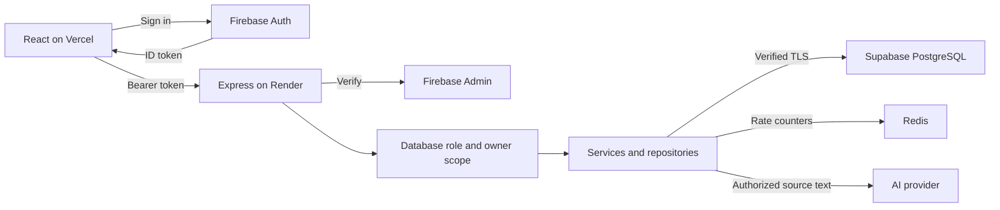

# Architecture decisions

## SmileCheck source review

Reviewed 2026-11-26 in `Z:/Antigravity Repo/SmileCheck-System`.

| Actual source | Observed convention applied here |
| --- | --- |
| `Backend/src/modules/contents/content.routes.ts` | Explicit ordered middleware, named controller namespace and Router per domain |
| `Backend/src/modules/contents/content.controller.ts` | Exported async handlers, explicit `Promise<void>`, response message/data and module error mapping |
| `Backend/src/modules/contents/content.service.ts` | Typed inputs, repository calls and typed ServiceError without Express arguments |
| `Backend/src/modules/contents/content.repository.ts` | Prisma data access isolated from HTTP |
| `Backend/src/utils/validators/content.validator.ts` | Zod schemas and parse/validation helpers |
| `Backend/src/utils/errorHandler/contentErrorHandler.ts` | Module-specific mapping and clean client errors |
| `frontend/src/hooks/usePolicy.ts` | Typed Query/Mutation hooks, meaningful staleTime, abort signals and invalidation after mutations |
| `Backend/tsconfig.json` | Strict TypeScript, ESM NodeNext and `@/*` imports |

Request trace reviewed from `useUpdatePolicy` through PUT `/api/content/policies/:type`, limiter, token and admin middleware, parameter/body validation, `updatePolicy` controller, service sanitization, `editPolicy` repository and Prisma. The query hook validates response data and updates/invalidates policy caches after success.

For this project use domain files in the approved top-level layer folders. A note request will pass through `routes/notes.routes.ts`, `controllers/notes.controller.ts`, `services/notes.service.ts`, `repositories/notes.repository.ts`, with `utils/input-validators/notes.ts` and `utils/error-handler/notes.ts`. A `client/src/features/notes/useNotes.ts` hook calls the shared authenticated Axios client using TanStack Query. Use explicit DTOs, exported readable functions and strict types. Formatting is standardized in P1-T20. The planned layer layout preserves the reviewed call flow.

## Version and dependency baseline

Checked 2026-11-26. Use Node 24.12.0 for the local rehearsal and Node 24 in deployment. Use npm lockfiles and exact direct versions. Requested major versions remain the baseline even where a newer major exists.

| Component | Selected line | Reason and compatibility |
| --- | --- | --- |
| TypeScript | 5.9.3 | Strict mode, NodeNext and relative extension rewriting |
| Express / types | 4 / 4 | Matches project rules and explicit async error handling |
| React / DOM | 19 / 19 | Matching versions with typed components |
| Vite / React plugin | 6 / 4 | Vite 6 supports Node 22+ including local Node 24 |
| Tailwind / Vite plugin | 4 / 4 | CSS-first configuration through the Vite plugin |
| Router | 7 | Declarative client routing and lazy route pages |
| Prisma / client / adapter-pg | 7, matching versions | ESM, explicit PostgreSQL adapter, config-owned datasource URL |
| Zod | 3 | Request, configuration and model output contracts |
| Query / Zustand | 5 / 5 | Server cache and temporary UI state respectively |
| Firebase client / Admin | Supported current majors at Phase 2 install | Verified UID identity boundary |
| TipTap | 3 at Phase 3 install | JSON document model, StarterKit and task list/item extensions cover required formatting |
| Recharts | 3 at Phase 5 install | React charts for line, bar and donut views with accessible data tables |
| Test tooling | Node test runner, Supertest, Testing Library, Vitest, Playwright | API unit/integration, React interaction and browser flows |

Only install dependencies when the current implementation needs them. Prisma, Redis and Firebase begin in Phase 2, the editor in Phase 3, provider SDK in Phase 4 and charts in Phase 5. P1-T17/T18 record exact installed patch versions in package manifests and lockfiles.

Version checks used npm registry engines and peer dependencies in addition to official documentation. Review source links before a future major upgrade. [Vite 6 guide](https://v6.vite.dev/guide/), [Prisma 7 upgrade requirements](https://docs.prisma.io/docs/orm/v6/more/upgrades/to-v7), [React Router installation](https://reactrouter.com/start/declarative/installation), [TanStack Query installation](https://tanstack.com/query/latest/docs/framework/react/installation), [TipTap StarterKit](https://tiptap.dev/docs/editor/extensions/functionality/starterkit), [TipTap task lists](https://tiptap.dev/docs/editor/extensions/nodes/task-list), [Recharts installation](https://recharts.github.io/en-US/guide/installation/).

## System boundaries



A note read verifies the token and database role, then queries Note through Project.ownerId. The controller serializes an allow-listed DTO. An AI request resolves every source note and revision before reserving quota and sending selected content with synthetic source IDs to the provider.

## Proposed folder layout

```text
client/src/
  api/
  components/ui/
  features/        # auth, dashboard, projects, notes, summaries, quizzes,
                   # quiz-history, analytics and settings
  pages/           # lazy route entries
  hooks/
  store/
  routes/
  types/
  utils/
  config/
server/
  server.ts        # listener
  config/          # env, database, Firebase, Redis
  prisma/          # schema modules and migrations
  prisma.config.ts
  src/
    app.ts
    routes/
    controllers/
    services/
    repositories/
    middlewares/
    utils/input-validators/
    utils/error-handler/
    utils/rate-limiter/
    types/
    ai/prompts/
    ai/tools/
  tests/
docs/
```

React is the view layer. Controllers own HTTP concerns, services own workflows and repositories own Prisma calls. Query keys include the current user ID. Zustand holds temporary UI state. Cancel and clear old queries and drafts before mounting a different account.

## Rich text and save decisions

Use TipTap 3 JSON with a schema version, StarterKit and task-list/task-item support. Required nodes cover paragraphs, headings, bullet/ordered/check lists, code and quotes, with bold/italic/underline marks. Store canonical JSON and derive plainText on the server for search and AI. JSON preserves semantics and reliable traversal but requires schema migrations and renderer compatibility. HTML is portable but requires sanitization and makes structural validation harder.

Validate nodes, attributes, length and links server-side. Render allow-listed React/editor nodes and sanitize HTML on any future export boundary. Exclude embedded scripts, raw HTML and arbitrary attributes. Checklists extract their text and checked state for generation.

Autosave debounces and serializes changes per note. PATCH includes expectedRevision. Update atomically WHERE id, owner and revision match, incrementing revision on success. One concurrent writer wins and the other receives 409. Preserve the losing local draft and offer reload/compare/reapply. Cancel queued work on navigation and account changes. Do not replay a stale draft automatically.

## Scaffold verification adjustment

TypeScript 5.9 rejects alias imports ending in .ts when rewriteRelativeImportExtensions is enabled (TS2877). Use .js for @/ imports under NodeNext, as observed in SmileCheck. Relative imports may use .ts and are rewritten by TypeScript. tsc-alias converts emitted aliases into runnable relative paths. Both tsx watch and compiled startup were verified locally.

## Formatting and lint baseline

ESLint 10, typescript-eslint 8 and Prettier 3 are pinned in each package. React lint rules check hooks and refresh boundaries. Both projects use single quotes, trailing commas, 90-column formatting and LF endings. Both lint and format checks pass. A disposable unused-variable probe failed lint as expected in each project and was removed. The initial ESLint 9 dependency reported end-of-support, so it was replaced with compatible ESLint 10 before the task commit.
