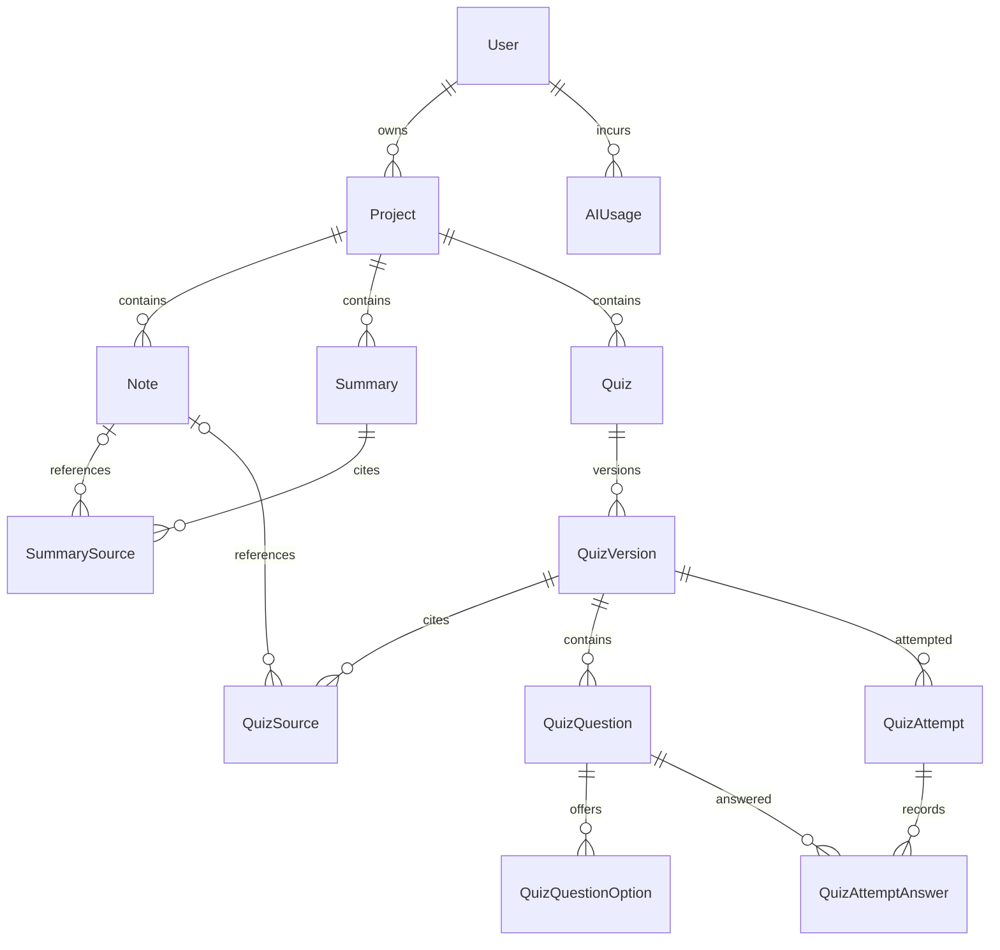

# Database design

This is the Phase 1 design. Phase 2 will implement and validate Prisma models and migrations against isolated PostgreSQL. Use UUID primary keys, timestamptz(6) dates, createdAt defaults and updatedAt for mutable entities. Prisma 7 uses the prisma-client generator, a config-owned URL and PrismaPg adapter.

| Model | Fields and constraints beyond UUID id | Indexes and purpose |
| --- | --- | --- |
| User | unique firebaseUid, displayName, email, role enum USERS/ADMIN/STAFF, createdAt, updatedAt | Unique UID supports idempotent synchronization |
| Project | ownerId FK User restrict, title, description, color, icon, archivedAt, deletedAt, revision, dates | ownerId/deletedAt/updatedAt/id for private paginated lists |
| Note | projectId FK Project restrict, title, content Json, contentSchemaVersion, plainText, revision, pinned, archivedAt, deletedAt, lastOpenedAt, dates | projectId/deletedAt/pinned/updatedAt/id and title search |
| Summary | projectId FK Project restrict, title, content Json, settings Json, generatedAt, deletedAt, dates | projectId/generatedAt/id |
| SummarySource | summaryId FK Summary cascade, nullable noteId FK Note set-null, sourceKey, noteTitle, revision, excerpt/range, contentHash | unique summaryId/sourceKey, noteId |
| Quiz | projectId FK Project restrict, title, deletedAt, dates | projectId/deletedAt/updatedAt/id |
| QuizVersion | quizId FK Quiz restrict, version Int, difficulty enum, explanation setting, generatedAt, promptVersion | unique quizId/version |
| QuizSource | quizVersionId FK QuizVersion cascade, nullable noteId FK Note set-null, sourceKey, title, revision, contentHash, range | unique quizVersionId/sourceKey, noteId |
| QuizQuestion | versionId FK QuizVersion restrict, position, type enum, prompt, explanation, acceptedAnswers Json, sourceKeys Json | unique versionId/position and unique id/versionId |
| QuizQuestionOption | questionId FK Question cascade, position, text, isCorrect | unique questionId/position |
| QuizAttempt | versionId FK Version restrict, mode, status enum IN_PROGRESS/ABANDONED/COMPLETED, requestKey, questionOrder Json, optionOrder Json, startedAt, finishedAt, correctCount, answeredCount, totalQuestions | unique versionId/requestKey, versionId/startedAt/id |
| QuizAttemptAnswer | attemptId, questionId, versionId, selectedOptionIds Json or text, isCorrect, submittedAt | unique attemptId/questionId, composite FKs enforce version membership |
| AIUsage | userId FK User restrict, requestKey, inputHash, operation, provider/model, status, token counts, reservedTokens, leaseExpiresAt, estimatedCost Decimal, pricingVersion, resultId, dates | unique userId/requestKey, userId/createdAt/status |

Attempt requires unique id/versionId so an answer's composite FK can reference both attempt and question with the same versionId. Services validate option membership and typed answer shape before writes. This explicit version field enforces consistency. ResultId references a typed artifact through validated service logic and operation, with atomic artifact/usage settlement.

Source join records express many-to-many links and preserve the original title/revision after a note moves. Quiz sources belong to a version so edits cannot rewrite provenance. Structured question snapshots are immutable once persisted. A new author edit creates another version. Scoring counts on completed attempts are immutable results of the stored answer set, while aggregates are queried at read time.

## Design fixture

Alice owns Networking with OSI revision 2 and TCP/IP revision 4. Summary S has two SummarySource rows. Quiz Q version 1 has four questions and two QuizSource rows. Attempts A1 and A2 reference version 1 with independent answer rows. Moving OSI to another Alice project changes Note.projectId while S and Q retain original project ownership and source revision metadata. Deleting OSI hides it and preserves its sources, questions and both scores. A later Q version 2 leaves A1/A2 on version 1.

All foreign keys receive explicit referential actions during Phase 2. Hard deletion is a separate retention operation with an owner-scoped transaction. Derived global/project statistics receive no duplicate counter tables.

## Retention and lifecycle

| Action | Workspace effect | Historical effect |
| --- | --- | --- |
| Archive project | Read-only until restore, hidden from default lists | Notes and study records retain IDs and dates |
| Archive note | Hidden from default note/source selections | Existing citations and attempts remain |
| Delete note | Soft delete with confirmation | Source title/revision/hash and immutable questions remain |
| Delete summary or quiz | Soft delete, hidden from library | Quiz attempts and pinned versions remain reviewable |
| Delete project | Preview impact and confirm project revision in a transaction, soft delete workspace | Historical attempt views keep tombstoned project title and versions |
| Hard purge | Separate explicit destructive retention process | Remove children in dependency order after retention/backup checks |

Retain soft-deleted study records until the owner requests a purge or account deletion. Account deletion must disclose the impact and reconcile Firebase identity removal with database purge using retryable operations. Enforce backup retention separately in deployment policy. No timed purge is introduced in the MVP.

Preview includes project revision and content counts. Child mutations increment project revision so a changed impact requires a new preview. Project archive status is checked during writes inside the same transaction.

Reviewed cases include a checklist round-trip through JSON and plain text, two updates both using revision 5 with only one revision 6 winner, and deleting a project with completed attempts while preserving review access through history.

## Implemented index inventory

Project indexes ownerId/deletedAt/updatedAt/id for owned paginated lists. Note indexes projectId/deletedAt/pinned/updatedAt/id plus title and creation-order variants. Summary uses projectId/generatedAt/id and Quiz uses projectId/deletedAt/updatedAt/id. Source joins index noteId for stale-source checks. Attempts index versionId/startedAt/id and status/startedAt for history/expiry. Usage indexes userId/createdAt/status and status/leaseExpiresAt. Unique quizId/version and questionId/position constraints also provide lookup indexes. Bounded substring search will begin with Prisma contains/insensitive filters on owned notes, with full-text/trigram indexing only after measured need. Stable pagination tests include 25 records with identical timestamps. Production-sized query plan measurement remains a later optimization check.
