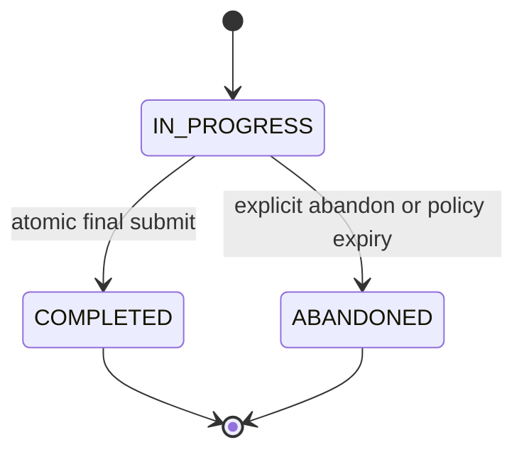

# Quiz scoring and history

A Quiz owns immutable numbered QuizVersions. Generation, author edits and regeneration create a fresh version. Each attempt pins one version and stores question and option order by stable IDs. A retake creates another attempt and reads the same saved version without an AI call. Old source revisions, questions, options and grading keys remain fixed.

Unfinished attempts remain resumable for seven days after start. A later read can atomically abandon an expired attempt. Abandoned attempts keep recorded answers but do not enter scored analytics. Server timestamps measure start-to-finalization wall time including pauses, labeled elapsed time.

| Type | Deterministic scoring rule | Reviewed example |
| --- | --- | --- |
| Multiple choice | Exactly one selected valid option equals the answer key | B versus B earns one |
| True/false | Boolean choice maps to one of two stable option IDs | True versus False earns zero |
| Identification | NFKC normalize, trim, collapse whitespace and Unicode lowercase, compare against explicit accepted variants | ' TCP/IP ' matches 'tcp/ip' |
| Multiple select | Selected distinct ID set exactly equals key set, order ignored | [C,A] matches [A,C], [A] earns zero |

Every question has one point and no partial credit. Unanswered questions earn zero but are tracked separately from incorrect answers. Identification variants are authored or validated at generation time. Exact matching cannot reliably accept semantic paraphrases, spelling errors or ambiguous responses. Display accepted forms during review and allow future quiz versions to add alternatives.

## Disclosure and writes

| View | Open practice | Open exam | Completed |
| --- | --- | --- | --- |
| Player question | Prompt/options | Prompt/options | Immutable prompt/options |
| Submitted question feedback | Correct answer and enabled explanation only after answer commit | No key, correctness or explanation | Correctness and enabled explanation |
| Results endpoint | Unavailable | Unavailable | Full permitted answer review |
| Explicit owner authoring | Full keys | Full keys | Full keys |

The author owns the material and can inspect it through authoring. Exam mode controls the study player's disclosure and does not provide proctoring. Keep authoring query data outside player caches.

Practice locks each recorded answer and handles repeats idempotently. Exam drafts use optimistic answer revisions and stay editable until finalization. The final submit transaction serializes with writes, scores stored answers, sets completion and timestamps once, then returns results. Repeat finalization returns identical results. Wrong-owner, wrong-version questions/options and post-completion writes fail.

## Reviewed history fixture

Version 1 contains a correct choice A. Attempt 1 chooses A and earns one. Version 2 changes the answer to B. Reviewing attempt 1 still yields A and one point. Retaking version 1 creates attempt 2 with a new ID and independently saved answer order. Repeating its start key returns attempt 2, while an explicit new start key creates attempt 3.

## Implemented scoring boundary

quiz-scoring.service.ts is pure and runs only on trusted immutable version questions. Duplicate or foreign option IDs and type-mismatched payloads are rejected. A partial multiple-select set is a valid submitted answer worth zero, with no partial credit. Clearing an exam choice or submitting blank identification text is unanswered; it is counted as skipped at completion, not incorrect. An unknown synonym is incorrect unless the version explicitly includes it among accepted variants. NFKC/whitespace/lowercase normalization preserves punctuation, so TCP/IP and TCP IP remain different. Server finalization scores every assigned question, including those with no answer row, and zero-question ratios are null.
